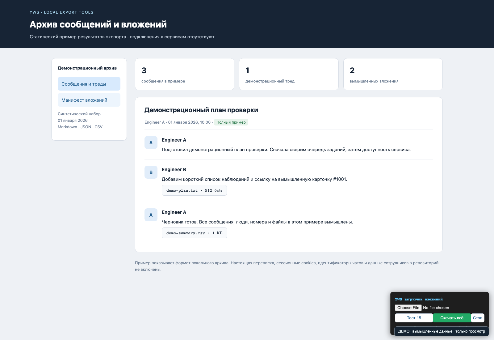
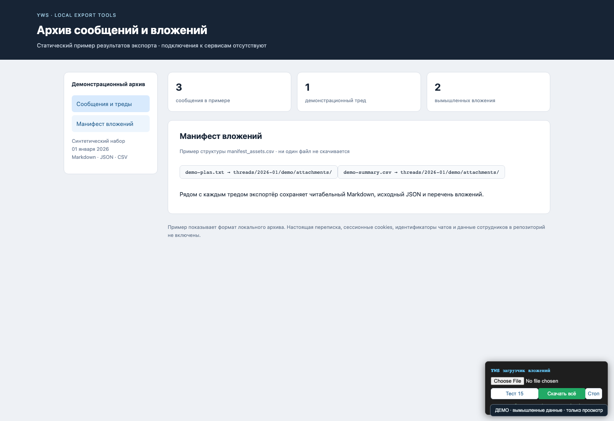

# Yandex Messenger Exporter

Инструменты локального экспорта сообщений, тредов и вложений из Yandex Messenger: сбор WebSocket-истории, нормализация DOM/WS-форматов, читабельный Markdown, JSON, CSV-манифест и загрузчик вложений.

Публичный репозиторий содержит только инструменты и вымышленный пример. Настоящая переписка, имена сотрудников, идентификаторы и ссылки приглашения в чаты, cookies, архивы, вложения и браузерные профили исключены. Онлайн-скрипты требуют отдельной локальной конфигурации и не имеют рабочего чата по умолчанию.

## Демонстрация

Скриншоты показывают статический вымышленный архив и интерфейс загрузчика. Они получены без входа в Yandex и без чтения настоящих сообщений.





```bash
python3 tools/demo.py
```

Скрипт выбирает новый свободный порт localhost и печатает адрес. Данные статические; внешние подключения отсутствуют, изменения запрещены. Ctrl+C останавливает этот отдельный сервер.

## Локальная обработка примера

```bash
python3 scripts/organize.py --base demo --raw input --out export
```

`organize.py` работает только с переданными локальными JSON и не обращается к Yandex. В `demo/input/` находится синтетический набор сообщений. Для собственных данных укажите `--base`, `--raw` и `--out`; каталоги `raw/` и `export/` игнорируются Git.

## Инструменты

| Файл | Назначение |
| --- | --- |
| `scripts/yws-config.example.js` | Пустой шаблон локальной настройки `window.YWS_CONFIG` |
| `scripts/yws-capture.user.js` | Перехват WS-кадров в явно открытом пользователем клиенте |
| `scripts/yws-fetch.js` | Чтение истории выбранных тредов с пагинацией |
| `scripts/yws-probe.js`, `scripts/yws-test-thread.js` | Диагностика формата истории |
| `scripts/organize.py` | Нормализация и построение локального архива |
| `scripts/download_assets.js` | Браузерный загрузчик выбранного манифеста |
| `scripts/download_local.py` | Загрузка вложений с cookies из локального файла или окружения |
| `autocollect.sh` | Копирование явно переданных пользователем файлов экспорта |

Заполненную конфигурацию сохраняйте как `config.local.js`. Сессионные cookies храните отдельно, а не в коде или командной строке. Сбор и скачивание выполняйте только из разрешённого вам аккаунта и чатов; в этой публикации проверены синтаксис и обработка вымышленного локального архива, онлайн-клиент не запускался.

## Локальные секреты

[Шифрование локальных файлов и проверка публикации](documentation/SECURITY.md). Исходники cookies и их зашифрованные копии исключены из Git; пароль вводится только в терминале.
